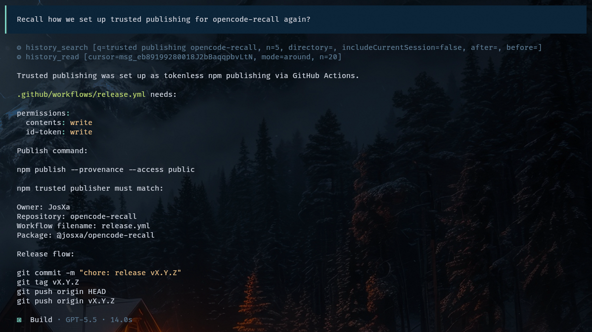
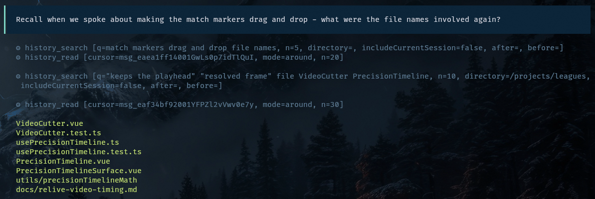
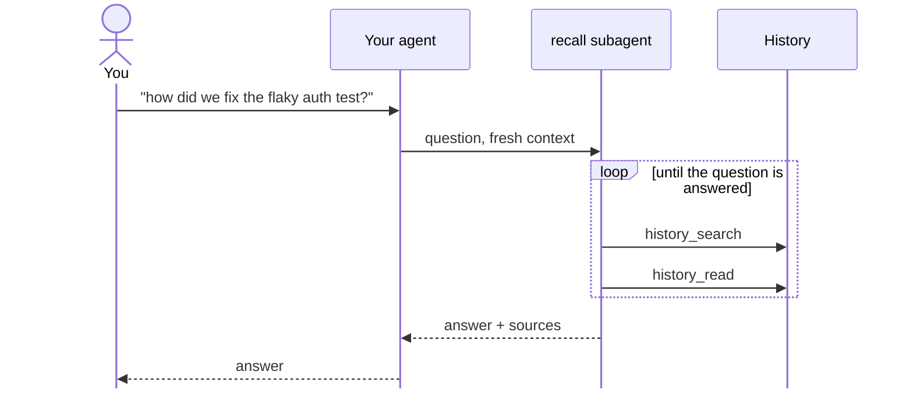
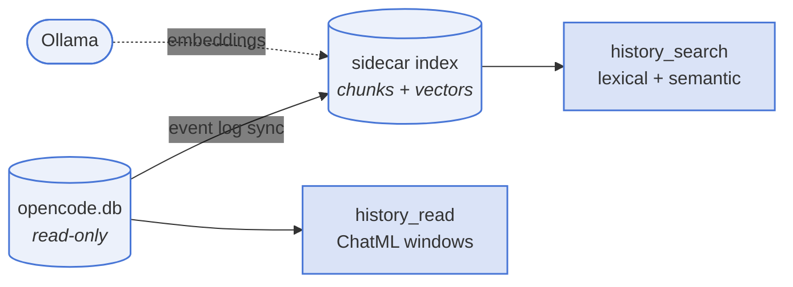

<div align="center">


# opencode-recall

**Search and read your past [OpenCode](https://opencode.ai) sessions from any new session.**

<a href="https://www.npmjs.com/package/@josxa/opencode-recall"></a>
<a href="https://github.com/JosXa/opencode-recall/actions/workflows/ci.yml"></a>


<a href="https://github.com/JosXa/opencode-recall/blob/main/LICENSE"></a>

[**Install**](#-install)&nbsp;&nbsp;&nbsp;[Usage](#-usage)&nbsp;&nbsp;&nbsp;[Configuration](#-configuration)&nbsp;&nbsp;&nbsp;[Tool reference](#-tool-reference)&nbsp;&nbsp;&nbsp;[How it works](#-how-it-works)

<br>



</div>

<br>

OpenCode stores every session in a local database, and a new session has no tool to search it. Six weeks ago you fixed this exact error in another project, and last month you worked out the release steps in a session you can't find anymore. Recall adds the tools to find those sessions and read their messages.

##  Why Recall?

🔎 **Search every project.** Recall combines word matching with semantic search over the sessions of every project you opened in OpenCode.

📜 **Read the original messages.** `history_read` returns a bounded window of messages around a match. Tool calls, patches and attachments appear as structured ChatML.

🎯 **Runs on request.** Recall adds old messages to the prompt only when you mention `@recall` or ask about an earlier session, so you can trace every excerpt to a request.

🔒 **Local and read-only.** Recall opens `opencode.db` read-only. The embedding index is a separate SQLite file that you can delete at any time.

### Compared with memory plugins

Memory plugins extract statements from your sessions and add them to the prompt of every new session. A statement extracted from a one-off guess is added as often as a confirmed fact, and it stays in every prompt after the code changes. Recall stores a search index of the transcripts that OpenCode already writes, and adds transcript excerpts only for a request.

| | Memory plugins | Recall |
|---|---|---|
| Stored data | Statements extracted from sessions | A search index of the existing transcripts |
| Added to the prompt | At the start of every session | When you mention `@recall` or ask about an earlier session |
| Added text | Short statements without their source | Original messages with session ID, directory and date |
| Outdated statements | Stay in every prompt until you delete them | Show their date, so you can judge whether they still apply |

##  What it looks like

<table>
<tr>
<td width="50%" valign="top">
<a href="https://github.com/JosXa/opencode-recall/blob/main/assets/screenshot-01.png"></a>
<p><b>"Remind me how we did this."</b><br><sub>One search and one read return the actual config and commands.</sub></p>
</td>
<td width="50%" valign="top">
<a href="https://github.com/JosXa/opencode-recall/blob/main/assets/screenshot-02.png"></a>
<p><b>"Which files were involved?"</b><br><sub>When the first search returns too little, the agent narrows the query and filters by project.</sub></p>
</td>
</tr>
</table>

##  Install

```sh
opencode plugin @josxa/opencode-recall -gf
```

This installs the package and adds it to your global OpenCode config.

<details>
<summary>Manual installation</summary>

<br>

```sh
pnpm add -D @josxa/opencode-recall
```

Then register the plugin in `opencode.json` or `~/.config/opencode/opencode.json`:

```jsonc
{
  "$schema": "https://opencode.ai/config.json",
  "plugin": ["@josxa/opencode-recall"]
}
```

</details>

### Search by meaning with Ollama

Recall uses a local [Ollama](https://ollama.com) installation to match questions by meaning. After you [install Ollama](https://ollama.com/download), check that it is on your `PATH`:

```sh
ollama --version   # prints a version when Ollama is installed
```

On the first search, Recall starts Ollama if needed, downloads a small embedding model[^model] and builds its index.

> [!NOTE]
> Without Ollama, Recall matches exact words only, so a rephrased question finds fewer sessions.

##  Usage

Mention `@recall` whenever old context would help:

```text
@recall how did we set up trusted publishing last time?
@recall find the session where we debugged the Postgres connection pool
@recall what did we decide about the rate limiter design?
```

Requests without `@recall` work as well when they ask about earlier sessions, because the main agent delegates them to the `recall` subagent:

> *"Did we ever debug the Postgres connection pool exhaustion? Find that conversation."*<br>
> *"Search my history for anything about Figma MCP and Azure."*<br>
> *"What were the file names involved when we worked on the timeline component?"*

### How the `recall` subagent works

The searches run in a separate `recall` subagent, so their tool output stays out of your main conversation:



1. **Fresh context.** The subagent starts with your question as its only context.
2. **Search and read.** It runs `history_search`, loads the messages around a promising hit with `history_read`, and changes the query, filters by directory or reads further when the results do not answer the question.
3. **Short answer.** The main agent receives the findings and the source sessions (ID, title and directory). The raw transcript pages stay in the subagent's context.
4. **Follow-ups.** For a follow-up question, the main agent calls `@recall` again, which searches the transcripts again.

> [!IMPORTANT]
> The `recall` subagent has permission for the four history tools only. Check facts from old sessions against the current code before you rely on them.

##  Configuration

Recall creates `recall.jsonc` in the OpenCode config directory (usually `~/.config/opencode/recall.jsonc`) on first use. Edit it to read an OpenCode database from another path, to store the index elsewhere, or to try another embedding model. For editor completion, set `"$schema"` to the [config schema](https://raw.githubusercontent.com/JosXa/opencode-recall/main/schema/config.schema.json).

```jsonc
{
  "database": {
    // opened read-only
    "path": "~/.local/share/opencode/opencode.db",
    // safe to delete, rebuilt on the next search
    "indexPath": "~/.local/share/opencode/opencode-recall-index.db"
  },
  "embeddings": {
    "ollamaUrl": "http://127.0.0.1:11434",
    // "mxbai-embed-large" matches better but is slower and uses more memory
    "model": "all-minilm"
  }
}
```

| Environment variable | Overrides |
|---|---|
| `OPENCODE_DB_PATH`, `OPENCODE_RECALL_DB_PATH` | `database.path` and any configured source list |
| `OPENCODE_RECALL_OLLAMA_URL` | `embeddings.ollamaUrl` |
| `OPENCODE_RECALL_EMBED_MODEL` | `embeddings.model` |

Use them for CI, MCP and temporary experiments. Run `pnpm run eval:embeddings` to compare installed embedding models against the [local regression cases](https://github.com/JosXa/opencode-recall/blob/main/docs/real-history-regressions.md).

### Give Recall its own model

Recall uses OpenCode's own `agent.recall` configuration. The plugin supplies the description, subagent mode, prompt and history-only permissions. You control `model`, `variant`, `temperature` and the other agent settings:

```jsonc
// ~/.config/opencode/opencode.json
{
  "agent": {
    "recall": { "model": "example-provider/recall-mini", "variant": "low" }
  }
}
```

The `recall` subagent uses this model when the main agent runs another one. Without `agent.recall`, OpenCode's default model applies.

### Read V1 and V2 history from either runtime

Put the same named sources into both runtimes' `recall.jsonc`:

```jsonc
{
  "database": {
    "sources": [
      {
        "id": "v1",
        "path": "~/.local/share/opencode/opencode.db",
        "indexPath": "~/.local/share/opencode/recall-v1.db"
      },
      {
        "id": "v2",
        "path": "~/.local/share/opencode/opencode-v2.db",
        "indexPath": "~/.local/share/opencode/recall-v2.db"
      }
    ]
  }
}
```

Results then carry a `sourceId`, and cursors are qualified, such as `v1::msg_example` or `v2::ses_example`.

<details>
<summary>Rules for sources, cursors and the SDK</summary>

<br>

- **One sidecar per source**, shared by all Recall hosts. Event cursors, embeddings, sync locks and stale-row cleanup stay local to that source. Missing sources are skipped without opening or pruning their sidecars. A cursor that names an unavailable source reports an error.
- **Source IDs** must be unique and contain only letters, digits, `_` or `-`. Keep them stable across configs so saved cursors stay usable.
- **Paths:** each canonical source path and each sidecar must be unique, and a sidecar cannot alias a source. Symlinks are resolved. A sidecar records its source identity atomically, so conflicting configurations fail instead of indexing the wrong database. Existing unbound indexes are rebuilt when first bound. Use fresh sidecars per source when you migrate a previously shared index.
- **Cursors:** copy qualified values exactly into read and save calls, including navigation cursors, without offsets. Raw `msg_…` and `ses_…` IDs work when only one available source contains them. An ambiguous ID produces an error that lists the qualified choices.
- **Merging:** copies in different sources stay distinct. Ranking, result limits, recent entries and session lists merge across sources. A qualified `excludeSessionId` filters one source; a raw one applies to all.
- **SDK:** pass the same list to `new OpenCodeRecall({ sources: [...] })` or `searchHistory(query, { sources: [...] })`.
- **Single source:** `database.path`/`database.indexPath` and the SDK's `historyDbPath`/`sidecarDbPath` still work, with unqualified cursors. Default sidecars are named `opencode-recall-<source-path-hash>.db`, so V1 and V2 cannot share an index by accident. The former `legacyPath` option maps to a separate `legacy` source.

</details>

##  Tool reference

Only the `recall` subagent has access to these four history tools.

| Tool | Purpose |
|---|---|
| [`history_search`](#history_search) | Ranked hits for a query, or the most recent messages |
| [`history_read`](#history_read) | A bounded ChatML window around a cursor |
| [`session_index`](#session_index) | Sessions by recency, with size signals |
| [`session_save`](#session_save) | Write a full session transcript to a file |

<details>
<summary><h3>history_search</h3></summary>

| Arg | Type | Notes |
|---|---|---|
| `q` | string | Free-text query. Empty lists the most recent messages. |
| `n` | number | Max hits. Default `8`, max `25`. |
| `directory` | string | Exact session directory. |
| `after`, `before` | ISO date | Message time range. `before` defaults to *now − 30 s*. |
| `includeCurrentSession` | boolean | Include the calling session. Default `false`. |

```jsonc
[
  {
    "cursor": "msg_…",  // pass to history_read
    "sid": "ses_…",
    "dir": "/Users/you/projects/foo",
    "title": "Figma MCP server on Azure API Center",
    "time": "2026-04-12T08:21:44.000Z",
    "role": "assistant",
    "score": 0.7421,
    "text": "…snippet capped at 280 chars…"
  }
]
```

</details>

<details>
<summary><h3>history_read</h3></summary>

| Arg | Type | Notes |
|---|---|---|
| `cursor` | string | **Required.** An exact cursor from search or navigation. |
| `mode` | string | `around` (default), `next`, `prev`, `head` or `tail`. `full` is rejected. |
| `n` | number | Message count. Default `12`, max `50`. |

```xml
<hist sid="ses_…" dir="/…" mode="around" range="42-53" anchor="48" total="120" title="…">
<|im_start|>user name="msg_…" index="42" time="2026-04-12T08:21:44.000Z"
…text and tool_call blocks…
<|im_end|>
<nav cur="…" prev="…" head="…" next="…" tail="…" />
</hist>
```

Capped content carries `truncated` and `original_chars` markers. `<nav/>` gives cursors for paging without a new search. To read from the end, start with `mode="tail"` and follow `prev`. `full` is rejected because large responses can be cut off by the tool transport.

</details>

<details>
<summary><h3>session_index</h3></summary>

| Arg | Type | Notes |
|---|---|---|
| `n` | number | Max sessions. Default `20`, max `100`. |
| `title` | string | Case-insensitive title filter. |
| `directory` | string | Exact session directory. |
| `after`, `before` | ISO date | Update time range. `before` defaults to *now − 30 s*. |
| `includeCurrentSession` | boolean | Include the calling session. Default `false`. |

```jsonc
[
  {
    "cursor": "ses_…", "sid": "ses_…", "title": "Release debugging notes",
    "directory": "/Users/you/projects/foo", "updated": "2026-04-12T08:21:44.000Z",
    "messages": 84, "turns": 18, "assistantMessages": 32, "toolMessages": 9,
    "textParts": 76, "approxContextChars": 118420
  }
]
```

Without a title filter, it lists the most recent sessions with their sizes, which helps to find long sessions.

</details>

<details>
<summary><h3>session_save</h3></summary>

| Arg | Type | Notes |
|---|---|---|
| `cursor` | string | **Required.** An exact session cursor. |
| `path` | string | **Required.** Destination inside the workspace. Always overwritten. |
| `format` | `chatml` \| `markdown` \| `jsonl` | Default `chatml`. |

```jsonc
{ "path": "recall/ses_….chatml", "bytes": 48321, "messages": 94 }
```

</details>

##  How it works



- **Source of truth.** `opencode.db` is opened read-only.
- **Sidecar index.** Recall writes text chunks, content hashes and `Float32` embeddings to a separate SQLite file. Session titles are indexed as their own rows, so proper-noun queries match titles before noisy snippets.
- **Sync.** Each search reads OpenCode's event log and reconciles only changed sessions, including deletions. There is no watcher or background process.
- **Vector scoring.** The native `sqlite-vec` extension scores embeddings inside SQLite, so only the best candidates reach JavaScript. Vectors from another model or dimension are excluded.
- **Ranking.** Recall merges lexical and semantic candidates, scores them by the terms they share with the title, text and directory plus phrase matches, and keeps at most two hits per session. A second, smaller semantic pass adds paraphrases with high embedding similarity that the lexical filter missed.
- **Reads.** Windows come from `row_number()` over `(session_id, time_created, id)`. Parts are normalized to `text`, `tool`, `patch` and `file` and capped at 2,000 characters of tool input and 6,000 of output.

##  Development

```sh
pnpm install
pnpm run ai:check           # biome + tsc
pnpm test                   # deterministic ranking and cursor tests
pnpm run eval:real-history  # regression suite against your local opencode.db
pnpm run build              # emits dist/
```

`node scripts/benchmark-search.mjs BASELINE_ROOT SIDECAR` compares speed, peak memory and top-result overlap against a built baseline checkout. It starts fresh processes, alternates their order and measures vector search apart from embedding and lexical search. The style guide is in [`AGENTS.md`](https://github.com/JosXa/opencode-recall/blob/main/AGENTS.md).

##  License

[MIT](https://github.com/JosXa/opencode-recall/blob/main/LICENSE) © JosXa

[^model]: `all-minilm` by default. See [Configuration](#-configuration) to switch models.
